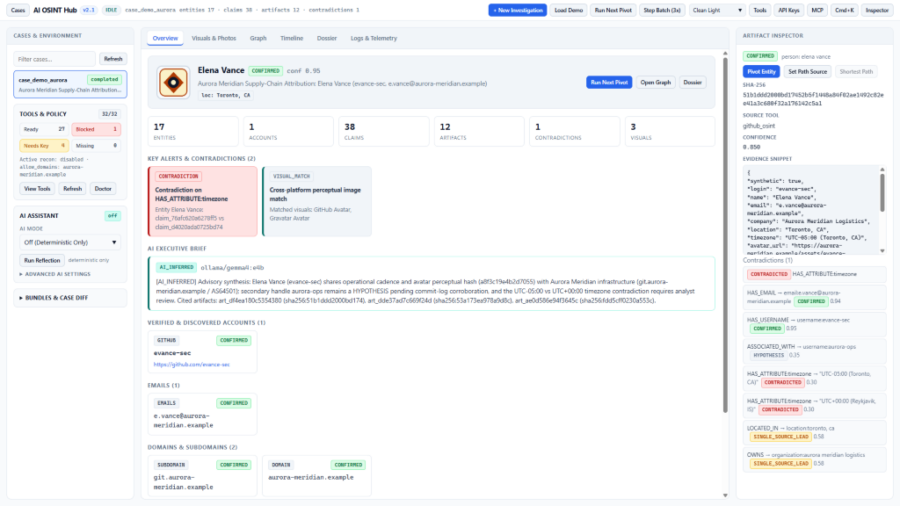
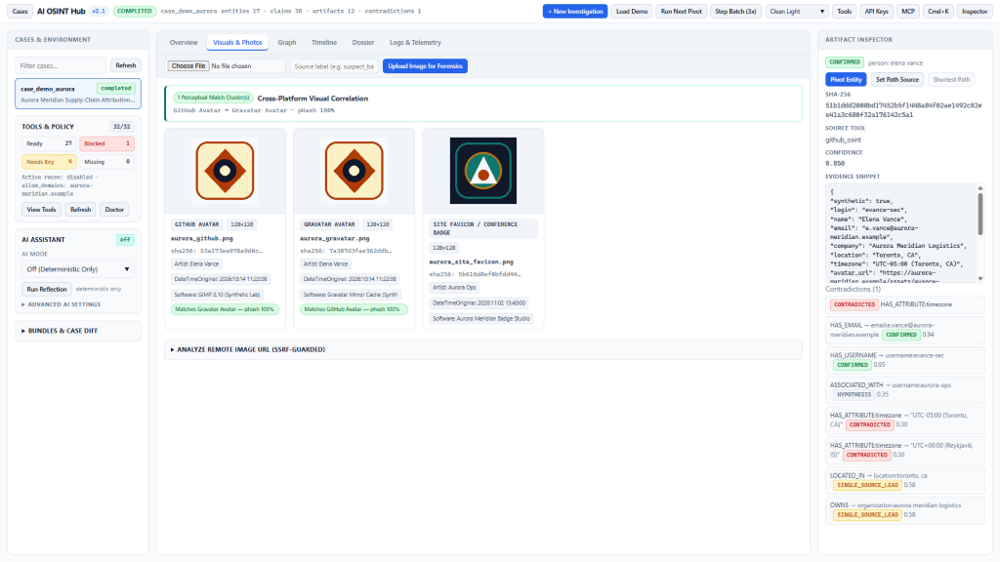
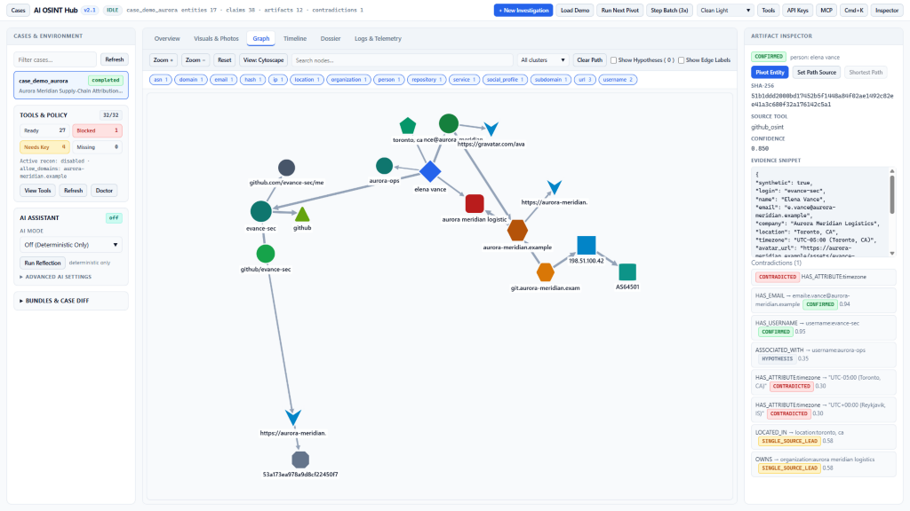
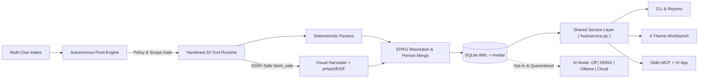

<div align="center">

# AI OSINT Hub

**Autonomous, Evidence-Backed OSINT Intelligence Workbench & Knowledge Graph**

[](https://github.com/hamidaliyev091/ai_osint_hub/actions/workflows/ci.yml)
[](https://github.com/hamidaliyev091/ai_osint_hub/releases)
[](pyproject.toml)
[](#32-tool-capability-matrix)
[](#optional-ai--visual-correlation)

*Entity-Resolved Knowledge Graph (SQLite/WAL) · Automatic SSRF-Safe Visual Forensics · 32 Hardened Collectors · 4 Responsive Themes · CLI, Web UI & MCP App*

</div>

---

## Why AI OSINT Hub?

Most OSINT scripts dump disconnected JSON walls and break silently on real targets. **AI OSINT Hub** separates deterministic intelligence collection from optional AI analysis inside an auditable, single-subject Knowledge Graph:

- **Every non-hypothesis claim cites an immutable `EvidenceArtifact`** (SHA-256 raw output, tool provenance, and closed 6-state `EpistemicStatus`: `CONFIRMED`, `CORROBORATED`, `SINGLE_SOURCE_LEAD`, `HYPOTHESIS`, `CONTRADICTED`, `COLLECTION_FAILURE`).
- **Zero-LLM Core by Default (`enabled=False`)**: Entity resolution, duplicate person unification, cross-platform pHash visual matching, and Markdown/JSON/HTML dossiers work 100% deterministically with zero API keys or GPU servers.
- **Built-In Visual Forensics & Photo Harvesting**: Automatically caches verified public avatars, Gravatar `d=404` probes, `og:image` thumbnails, and favicons through strict SSRF & image-magic guards, runs EXIF + `pHash`/`dHash` clustering, and supports forensic image upload.
- **Responsive Workbench Across Every Screen (`1280×800` to Ultrawide)**: Features 4 clean themes (`Clean Light` default, `Warm Paper`, `Midnight Slate`, `Gruvbox Dark`), an **Overview** tab for accounts & visuals, a **Visuals & Photos** gallery, a readable `cose` graph with matte label pills, and print-ready dossiers.

---

## Workbench Tour

| **Subject Overview (Accounts, Findings & Alerts)** | **Visuals & Photos (pHash Matching & EXIF Forensics)** |
| :---: | :---: |
|  |  |
| **Interactive Entity-Resolved Graph (`cose` + Inspector)** | **Evidence-Cited Dossier & Bundle Export** |
|  |  |

---

## 30-Second Quickstart

### 1. Local Install (Zero Ollama / LM Studio Required)

```bash
git clone https://github.com/hamidaliyev091/ai_osint_hub.git
cd ai_osint_hub
python -m venv .venv
# Linux / macOS: source .venv/bin/activate
# Windows PowerShell: .\.venv\Scripts\Activate.ps1
python -m pip install -e .

# Seed offline interactive demo (with synthetic avatar pHash match) & launch Web UI
python -m hub.cli demo
python -m hub.cli web --open
```

Optional built-in offline embeddings (`fastembed` ONNX Runtime, zero external daemon):

```bash
python -m pip install -e ".[local-ai]"
```

### 2. Docker (Non-Root Container, `UID 10001`)

```bash
docker compose up --build core
# Open http://127.0.0.1:8000
```

### 3. CLI & MCP Parity

```bash
python -m hub.cli doctor --no-smoke          # 32-tool inventory check
python -m hub.cli investigate "example.com" --max-iterations 3 --report html --out dossier.html
python -m hub.cli export case_demo_aurora --redact-pii --out aurora.osintcase.zip
python -m hub.cli mcp-config --client antigravity
```

---

## System Architecture



See [docs/ARCHITECTURE.md](docs/ARCHITECTURE.md) for deep technical details on ERKG scoring, bundle verification, and graph analytics.

---

## Security & Epistemic Model

Security controls live in code rather than prompt text ([SECURITY.md](SECURITY.md)):

- **Zero-Shell Subprocess Runtime (`hub/tools/runtime.py`)**: All binaries run via `create_subprocess_exec(*argv)` (`shell=False`, `stdin=DEVNULL`) with scrubbed environment variables and process-tree kill on timeout.
- **Code-Enforced Scope & Non-Intrusiveness (`hub/security/policy.py`)**: `allow_active_recon=False` by default; `INTRUSIVE_BLOCKED` capabilities (`hydra`) never execute automatically and display honestly as `BLOCKED` in `tools` and `doctor`.
- **SSRF & Media Safety (`hub/tools/builtin/_http.py`, `hub/tools/visual_harvester.py`)**: Host IP validation before socket connection and across redirect hops blocks loopback/private/link-local ranges (`169.254.169.254`). Image harvesting and uploads enforce a 5 MB cap, Pillow decode verification, SVG/HTML rejection, and `X-Content-Type-Options: nosniff`.
- **Quarantine & Non-Promotion (`hub/security/quarantine.py`)**: External text and visual EXIF strings are sanitized inside `<untrusted_osint_data>` / `<untrusted_visual_data>`. Optional AI insights carry `PROVENANCE_AI_INFERRED` (`direct=False`) and can never promote claims to `CONFIRMED`.
- **XSS-Free UI & Hardened `.osintcase.zip` (`hub/web.py`, `hub/bundle.py`)**: Strict DOM node construction (`createElement`/`textContent`), URL scheme allowlist (`http:`, `https:`, `mailto:`), and Zip-Slip/ratio/SHA-256 checks with SQLite `PRAGMA trusted_schema = OFF`.

---

## Optional AI & Visual Correlation

Select one of 4 clear modes in the Workbench (`Off` default):

| Mode | Dependency | What It Does |
|---|---|---|
| **Off (Default)** | None | 100% deterministic OSINT engine, ERKG resolution, EXIF + pHash/dHash correlation |
| **Built-in Local AI** | `.[local-ai]` (`fastembed` ONNX) | Offline bio/alias embeddings + CLIP image similarity without running Ollama |
| **Local Ollama / LM Studio** | Local daemon (`gemma4`, `qwen2.5vl`) | Interactive case reflection & contradiction synthesis |
| **Cloud BYOK** | User API key (`Gemini` / `DeepSeek` / OpenAI-compat) | Remote synthesis with automatic secret redaction & `<untrusted_*>` quarantine |

---

## 32-Tool Capability Matrix

`python -m hub.cli doctor` inventories **32 capabilities** across 4 execution posture tiers:

| Category | Capabilities (32 Total) |
|---|---|
| **Python-Native Passive Collectors (15)** | `dns_lookup`, `http_headers`, `tls_cert`, `crtsh_lookup`, `asn_bgp_lookup`, `favicon_hash`, `media_forensics`, `photon_crawler`, `github_osint`, `gravatar_lookup`, `pgp_keyserver`, `rdap_lookup`, `wayback_cdx`, `darkweb_ahmia`, `snscrape` |
| **Credentialed API Collectors (4)** | `virustotal_lookup`, `shodan_lookup`, `censys_lookup`, `hunter_lookup` |
| **Managed Passive OSINT CLIs (7)** | `theharvester`, `sherlock`, `maigret`, `holehe`, `phoneinfoga`, `ghunt`, `h8mail` |
| **Active Recon / Auth-Gated (5)** | `nmap`, `amass`, `gobuster`, `whatweb`, `hashcat` *(excluded unless `allow_active_recon=True` / explicit auth)* |
| **Intrusive Policy Blocked (1)** | `hydra` *(`INTRUSIVE_BLOCKED` — never auto-spawns; surfaced honestly as `BLOCKED`)* |

> **15 + 4 + 7 = 26 Passive + 5 Active/Auth-Gated + 1 Intrusive Blocked = 32 Total.** Run `python -m hub.cli tools` for live per-tool status and API credential readiness.

---

## Documentation & Release Hygiene

- [Architecture Overview](docs/ARCHITECTURE.md) · [MCP Integration Guide](docs/MCP_USAGE.md)
- [Security Policy](SECURITY.md) · [Changelog](CHANGELOG.md) · [Contributing](CONTRIBUTING.md)
- [Agent Operating Rules](AGENTS.md) · Project Metadata ([pyproject.toml](pyproject.toml))
