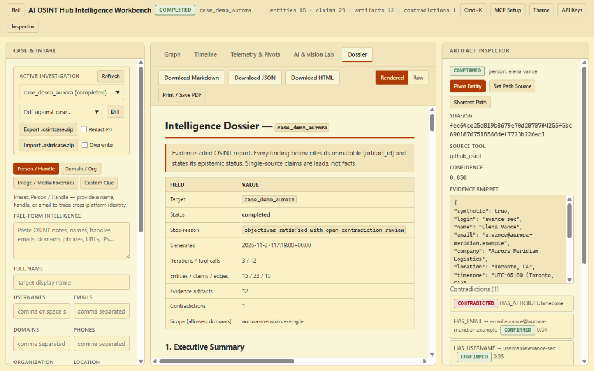
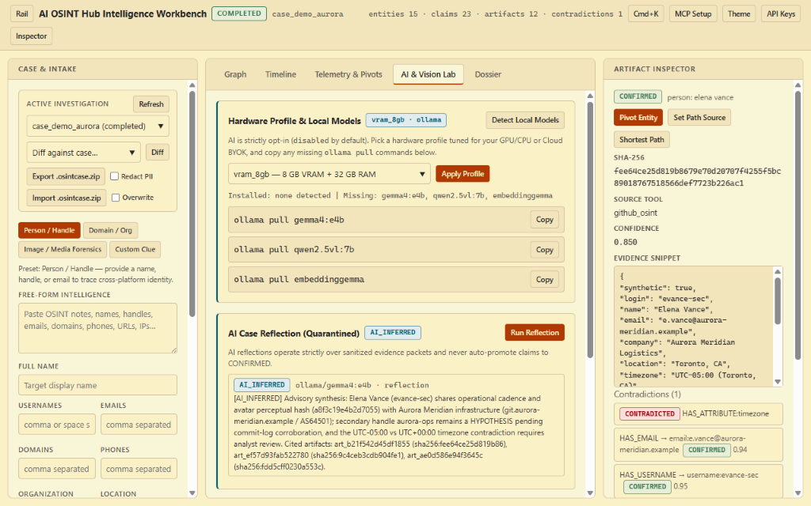

# AI OSINT Hub v2.0.0

**Autonomous, evidence-cited OSINT investigation** — from a target seed to a provenance-backed intelligence dossier. Not a bag of tool wrappers: the system's value is how it **thinks, remembers, correlates, and pivots**.


---

## Quickstart (Choose Your Path)

### 1. Install via `uv tool` or `pipx` (Recommended)

```bash
# uv (fast, isolated Python CLI)
uv tool install .
# or pipx:
pipx install .

# Launch the Gruvbox Web Workbench (auto-picks free port, opens browser)
ai-osint-hub web --open
```

### 2. One-Click Launchers (From Repo Checkout)

- **Windows (PowerShell 5.1):** `.\scripts\launch.ps1`
- **macOS / Linux:** `chmod +x scripts/launch.sh && ./scripts/launch.sh`

Both scripts create `.venv` (via `uv` or system Python 3.10+), install `ai-osint-hub`, and open the Web Workbench.

### 3. Docker & Docker Compose (Non-Root `UID 10001`)

```bash
# Core image (all 19 Python-native passive collectors + Web Workbench + MCP)
docker compose --profile core up --build
# Full image (+ nmap, gobuster, whatweb, hashcat, hydra, tesseract, holehe, maigret, sherlock, theHarvester)
docker compose --profile full up --build
```

Bound strictly to `127.0.0.1:8000` with persistent `/data` volume (`osint_data`) and optional local Ollama profile (`--profile ai`).

### 4. Try the Offline Interactive Demo Case (Zero Network I/O)

```bash
ai-osint-hub demo            # seeds synthetic case_demo_aurora ("Aurora Meridian")
ai-osint-hub web --open      # or click "Load Interactive Demo Case" in the Workbench
```

`case_demo_aurora` loads in `< 1s` with 15 entities, 23 claims (3-tool corroborated `CONFIRMED`, `CONTRADICTED` timezone conflict, `AI_INFERRED` advisory insight, synthetic PNG/EXIF/pHash forensics), and timeline events.

---

## Core Architectural Pillars

| # | Pillar | What it means in practice |
|---|---|---|
| 1 | **Epistemic Memory & ERKG** | SQLite/WAL Entity-Resolved Knowledge Graph (`hub/erkg/`). Every entity attribute and edge is a `Claim` citing immutable `EvidenceArtifact` records with a closed 6-value `EpistemicStatus` enum (`CONFIRMED`, `CORROBORATED`, `SINGLE_SOURCE_LEAD`, `HYPOTHESIS`, `CONTRADICTED`, `COLLECTION_FAILURE`) and deterministic confidence. |
| 2 | **Hypothesis-Driven Pivot Engine** | Explicit `CORROBORATION` / `RESOLUTION` / `EXPANSION` / `IDENTITY_LINK` / `VERIFICATION` hypotheses. Pivots are scored deterministically (`w1·EIG + w2·Corroboration - w3·HopPenalty - w4·Cost`) with execution-ledger deduplication and atomic per-iteration commits. |
| 3 | **32-Tool Registry & Cross-Platform Locator** | Pydantic manifests (`hub/tools/capabilities.py`) auto-generate LLM schemas, MCP definitions, and CLI tables. `hub/tools/locator.py` resolves managed bins, host PATH (including `/opt/homebrew/bin`, `~/.local/bin`), Windows `0xC0000142` venv trampoline bypasses, and WSL2 bridges (`wsl.exe -d Ubuntu --exec`). |
| 4 | **Hardened Security & Quarantine** | Zero-shell `create_subprocess_exec` (`shell=False`, `stdin=DEVNULL`), scrubbed env, process-tree timeout kill, pre-spawn scope & SSRF guards (`assert_safe_host`, `fetch_safe`), `allow_active_recon=False` default, `INTRUSIVE_BLOCKED` on `hydra`, `<untrusted_osint_data>` / `<untrusted_visual_data>` prompt quarantine, and hardened `.osintcase.zip` bundles. |
| 5 | **CLI + MCP + Gruvbox Workbench Parity** | Shared `InvestigationService` powers `ai-osint-hub` CLI, stdio MCP server + `ui://ai-osint-hub/workbench.html` MCP App, and the offline Gruvbox Material Light (`#fbf1c7`) FastAPI + Cytoscape.js 3-pane workbench. |

### Investigation Loop

```
raw intel / structured seeds ──► Intake + Seed Artifact (USER_PROVIDED_SEED)
                                       │
                                       ▼
   Plan (Hypotheses) ──► Score Pivots (ledger-filtered) ──► ToolRuntime (Policy + SSRF)
         ▲                                                         │
         │                                                         ▼
   Reflect (optional, quarantined) ◄── Correlate/Store (SQLite WAL) ◄── Stage-1 Parser
         │
         ▼ (stop condition met)
   Evidence-Cited Dossier (Markdown / JSON / Print-Ready HTML)
```

---

## CLI Workflows & Portable Bundles

```bash
# Verify toolchain (32 capabilities)
ai-osint-hub tools
ai-osint-hub doctor               # live --version/--help smoke check per tool
ai-osint-hub doctor --no-smoke    # fast binary inventory (CI-friendly)
ai-osint-hub doctor --provision   # install missing tools into managed dirs / WSL2

# Run an investigation (free text and/or structured flags; raw_input is optional)
ai-osint-hub investigate "example.com" --max-iterations 3 --max-tool-calls 4 --allow-domain example.com --report md
ai-osint-hub investigate --name "Elena Vance" --username evance-sec --domain aurora-meridian.example

# Manual step, analytics, timeline, diff, and dossiers
ai-osint-hub status <target_id>
ai-osint-hub step <target_id> [--action piv_xxx]
ai-osint-hub analytics <target_id> [--source <e1> --dest <e2>]
ai-osint-hub timeline <target_id>
ai-osint-hub diff <target_id_a> <target_id_b>
ai-osint-hub report <target_id> --format html --out dossier.html

# Export / import verified .osintcase.zip bundles (optional PII scrubbing)
ai-osint-hub export <target_id> --out case.osintcase.zip --redact-pii
ai-osint-hub import case.osintcase.zip [--target-id new_id] [--overwrite]
```

---

## 32-Tool Capability Matrix

19 Python-native collectors work out-of-the-box with zero external binaries (`Pillow>=10.0` included for `media_forensics`). Missing external binaries are reported as `MISSING` and never mocked.

| Category | Tools | Mode | Auth / Host Requirement |
|---|---|---|---|
| **Native Passive (Zero-Auth)** | `dns_lookup`, `http_headers`, `tls_cert`, `crtsh_lookup`, `asn_bgp_lookup`, `favicon_hash`, `media_forensics`, `photon_crawler`, `gravatar_lookup`, `pgp_keyserver`, `rdap_lookup`, `wayback_cdx`, `darkweb_ahmia`, `snscrape` | `PASSIVE` | Python-native (`httpx`, `Pillow`) |
| **Native Passive (API Key)** | `github_osint` (keyless or token), `virustotal_lookup`, `shodan_lookup`, `censys_lookup`, `hunter_lookup` | `PASSIVE` | Optional/vault API key (`ai-osint-hub auth set`) |
| **External Passive CLIs** | `holehe`, `maigret`, `sherlock`, `theharvester`, `phoneinfoga`, `ghunt`, `h8mail` | `PASSIVE` | Binary (`ghunt`/`h8mail` require session/config) |
| **Active Recon (Opt-In)** | `nmap`, `amass`, `gobuster`, `whatweb`, `hashcat` | `ACTIVE_RECON` | Requires `--allow-active-recon` (`hashcat` also auth-gated) |
| **Intrusive (Blocked)** | `hydra` | `INTRUSIVE_BLOCKED` | Never spawned without explicit `allow_intrusive` |

---

## Hardware-Adaptive AI & Vision Profiles (Optional)

The deterministic OSINT core runs with **zero LLM required** (`AIConfig.enabled = False`, `preset = disabled` by default). When enabled, all AI outputs carry `AI_INFERRED` provenance (`direct=False`, confidence `<= 0.35` reflection / `<= 0.45` VLM) and never elevate claims to `CONFIRMED`.

| Preset | Target Hardware | Provider & Models | `num_ctx` / `keep_alive` |
|---|---|---|---|
| `disabled` *(default)* | Any | Pure deterministic core (offline TF-IDF/Jaro-Winkler similarity) | — |
| `cpu_light` | CPU-only (`<= 8 GB` RAM) | Ollama (`qwen2.5:3b`, `embeddinggemma`) | `4096` / `60s` |
| `vram_8gb` | 8 GB VRAM + 32 GB RAM | Ollama (`gemma4:e4b`, `qwen2.5vl:7b`, `embeddinggemma`) | `8192` / `90s` |
| `vram_16gb_plus` | 16+ GB VRAM Workstation | Ollama (`gemma4:12b`, `qwen2.5vl:7b`, `embeddinggemma`) | `16384` / `5m` |
| `cloud_byok` | Remote API | Gemini, DeepSeek, or OpenAI-compatible (user key only) | `8192` / `2m` |

Check AI readiness & copyable `ollama pull` commands via `ai-osint-hub ai status --probe` or the Workbench **AI & Vision Lab** tab.

---

## 10-Second MCP Setup

Generate ready-to-paste config for **Antigravity**, **Claude Desktop**, **Cursor**, or **VS Code**:

```bash
ai-osint-hub mcp-config --client antigravity   # or claude | cursor | vscode
```

Or click **10-Second MCP Setup** inside the Web Workbench. See [docs/MCP_USAGE.md](docs/MCP_USAGE.md) for full client instructions and the `ui://ai-osint-hub/workbench.html` MCP App guide.

---

## Web Workbench Features

- **Gruvbox Material Light** (`#fbf1c7`) matte 3-pane layout + optional `[data-theme="dark"]` toggle, zero `backdrop-filter`, zero `innerHTML`.
- **Cytoscape.js 3.35.0** (vendored locally at `hub/static/vendor/cytoscape.min.js`) + synchronized `<svg id="graph">` fallback.
- **Ctrl/Cmd+K Command Palette** to jump to entities, switch tabs, run pivots, toggle theme, or load the demo case.
- **Rendered | Raw** DOM-built Markdown dossier viewer (`http:`/`https:`/`mailto:` links only) + print-ready PDF CSS.
- **Scope & Authorization Modal** before enabling `Allow Active Recon`.

### Workbench Preview

| Rendered Evidence-Cited Dossier | Hardware-Adaptive AI & Vision Lab |
|---|---|
|  |  |

---

## Security & Documentation

- [SECURITY.md](SECURITY.md) — threat model, SSRF & prompt-injection quarantine, bundle hardening, authorized-use policy.
- [CONTRIBUTING.md](CONTRIBUTING.md) — dev setup, offline test suite, and PR security invariants checklist.
- [CHANGELOG.md](CHANGELOG.md) — full `v2.0.0` release notes.
- [docs/MCP_USAGE.md](docs/MCP_USAGE.md) — MCP stdio & MCP App setup across AI clients.
- State directory: `$AI_OSINT_HUB_HOME` (default `~/.ai_osint_hub`). Run offline tests with `python -m pytest -q`.
