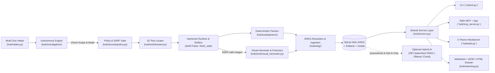

# AI OSINT Hub v2.1 Architecture

AI OSINT Hub is an autonomous, offline-first OSINT collection, Entity-Resolved Knowledge Graph (ERKG), visual forensics, and reporting workbench built around a **deterministic zero-LLM core** and code-enforced defensive boundaries.

## High-Level System Architecture

## Core Subsystems

### 1. Multi-Clue Intake & Deterministic ERKG (`hub/intake.py`, `hub/erkg/`)
- **Closed Epistemic Status (`hub/models.py`):** Every claim carries exactly one of `CONFIRMED`, `CORROBORATED`, `SINGLE_SOURCE_LEAD`, `HYPOTHESIS`, `CONTRADICTED`, or `COLLECTION_FAILURE`.
- **Entity Resolution & Person Unification (`hub/erkg/resolution.py`, `ingestion.py`, `store.py`):** Normalizes domains/subdomains with multi-label public suffixes, filters generic/path-fragment usernames (`members`, `about`, `login`), tags freemail and `*@users.noreply.github.com` provider infrastructure, and automatically merges duplicate `PERSON` nodes sharing verified unique handles or non-role emails.
- **Multi-Valued vs. Functional Predicates:** `HAS_EMAIL` and `LOCATED_IN` are multi-valued (never triggering false contradictions when a subject has personal + commit emails or city + country records), while `HAS_PHONE` and `REGISTERED_BY` remain functional.
- **Atomic SQLite WAL Store (`hub/erkg/store.py`):** One engine iteration executes inside a single SQLite transaction recording artifacts (with SHA-256 raw hashes), claims, contradictions, execution ledger entries, hypotheses, and iteration records.

### 2. Hardened 32-Tool Runtime, Cross-Platform Locator & Policy (`hub/tools/`, `hub/security/`)
- **Resolution Order (`hub/tools/locator.py`):** Managed launcher descriptors -> `~/.ai_osint_hub/bin` -> `.venv*` script entry-points (bypassing Windows `0xC0000142` trampolines) -> host `PATH` -> shell-free WSL2 (`wsl.exe -d <distro> --exec`) -> managed Python wrapper.
- **No Shell Interpolation (`hub/tools/runtime.py`):** Every external command executes via `create_subprocess_exec(*argv)` (`shell=False`, `stdin=subprocess.DEVNULL`) with scrubbed env and isolated scratch/toolhome folders.
- **Code-Enforced Policy (`hub/security/policy.py`):** `ACTIVE_RECON` requires `allow_active_recon=True`; `INTRUSIVE_BLOCKED` tools (`hydra`) never spawn without explicit override and surface honestly in Workbench/Doctor as `policy_blocked=True` (`ui_status="blocked"`).
- **Rate-Limit & Duplicate Guards:** 24h provider cooldown cache (`hub/tools/cooldown.py`) + same-case duplicate `github_osint` handle suppression (`hub/investigation/pivot.py`, `engine.py`).

### 3. SSRF-Safe Visual Harvesting & Perceptual Correlation (`hub/tools/visual_harvester.py`)
- Automatically discovers and caches safe public images (`avatar_url`, Gravatar `d=404` probes, `og:image` / `twitter:image`, site favicons) into `<case_dir>/media/`.
- Enforces `fetch_safe` + `assert_safe_host` (blocking private/loopback/link-local IPs across redirect hops), 5 MB size cap, 8s timeout, MIME + Pillow magic-byte validation, and explicit rejection of SVG/HTML active markup.
- Extracts SHA-256, dimensions, quarantined EXIF/XMP/IPTC/GPS metadata (`sanitize_visual_text`), 64-bit `dHash`/`pHash` for automatic cross-platform avatar matching, and optional CLIP embeddings when `[local-ai]` is active.

### 4. Parity Interfaces (`hub/service.py`, `hub/cli.py`, `hub/web.py`, `hub/mcp_server.py`, `hub/reporting.py`)
- **Shared Service Operations:** `investigate`, `step`, `overview`, `visuals`, `upload_visual`, `graph`, `analytics`, `timeline`, `diff`, `tools`, `report`, `doctor`, `export_bundle`, `import_bundle`.
- **Responsive 4-Theme Workbench (`hub/web.py`):** Enterprise `clean-light` default plus `warm-paper`, `midnight-slate`, and `gruvbox-dark`; `Overview` (subject card, grouped accounts/emails/phones/domains/repos, alerts), `Visuals & Photos` (gallery, EXIF/GPS, perceptual match clusters, forensic upload), readable `cose` Cytoscape graph with matte label pills & auto-selected primary subject, `Timeline`, `Dossier`, and `Logs & Telemetry`.
- **Strict XSS & Bundle Hardening:** Zero `innerHTML` / `outerHTML` / `document.write` / `eval` / `backdrop-filter`; URL scheme allowlist (`http:`, `https:`, `mailto:`); Zip-Slip/ratio/SHA-256/extension-allowlist bundle verification (`hub/bundle.py`).

### 5. Optional Hybrid AI (`hub/ai/`)
- Zero-LLM deterministic core default (`mode="off"`, `enabled=False`).
- Four clear user modes: `off` | `local_embedded` (`fastembed` ONNX `BAAI/bge-small-en-v1.5` + optional CLIP vision with deterministic offline fallback) | `ollama` | `cloud`.
- All external inputs sent to models pass through `<untrusted_osint_data>` / `<untrusted_visual_data>` quarantine and outputs carry `PROVENANCE_AI_INFERRED` (`direct=False`, bounded confidence <= 0.35 / 0.45) so AI never fabricates `CONFIRMED` findings.
