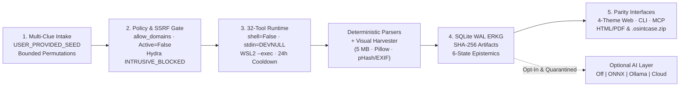
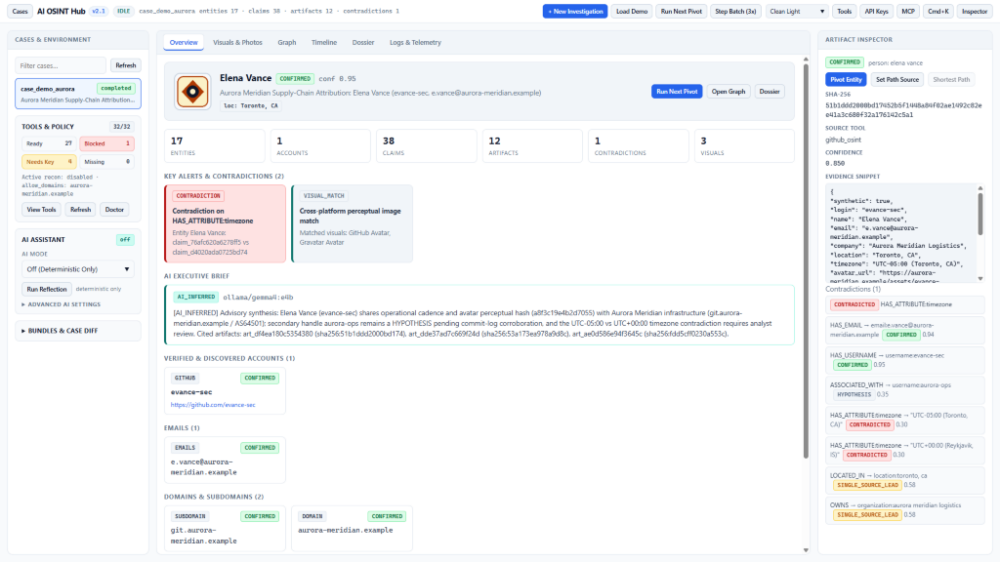
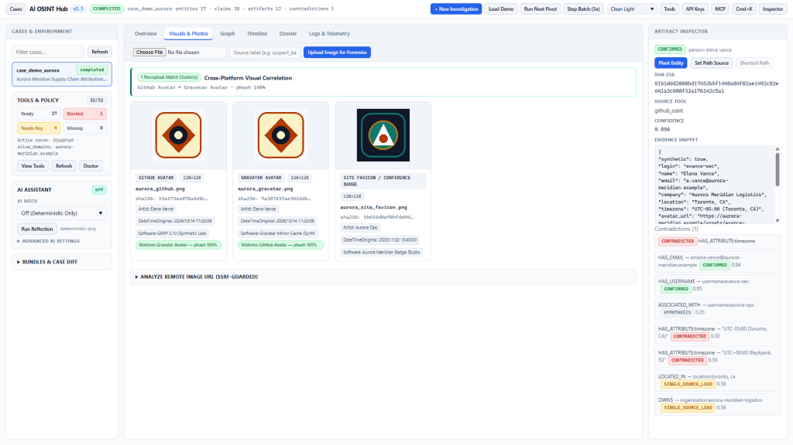
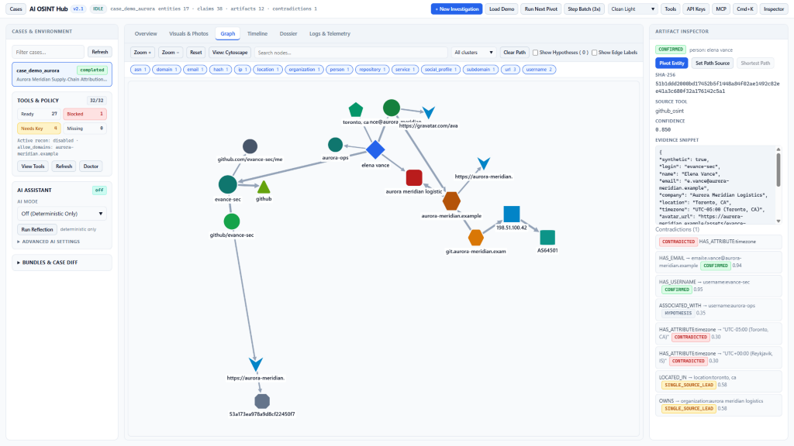
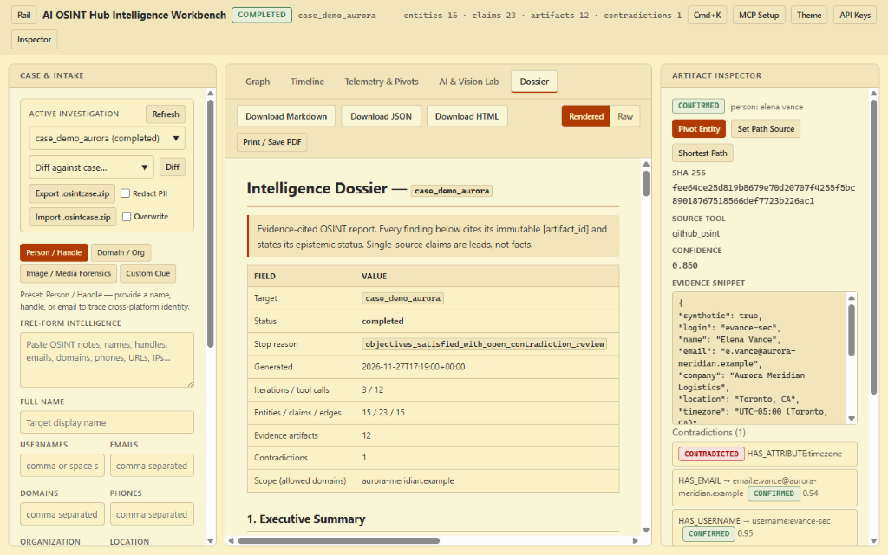

# AI OSINT Hub v2.1 — Evidence-Backed OSINT & Attribution Workbench

**Technical Architecture & Live Demo Presentation for PROSOL QSC**
- **Candidate:** Hamid Aliyev
- **Target Teams:** Cyber Threat Intelligence (CTI) · 24/7 SOC & DFIR · Red Team Reconnaissance · Security Engineering
- **Repository & Release:** `github.com/hamidaliyev091/ai_osint_hub` (`v2.1.0` · 745 offline tests · 7/7 CI jobs passing)
- **Deck Formats in `docs/`:**
  - Interactive 16:9 Web Deck: `docs/PROSOL_PRESENTATION.html`
  - Editable PowerPoint (16:9 `.pptx` with Speaker Notes): `docs/PROSOL_Presentation_Hamid_Aliyev.pptx`
  - Print-Ready 16:9 PDF Slides: `docs/PROSOL_Presentation_Hamid_Aliyev.pdf`

---

## Slide 1 — Executive Hook: Real OSINT Without Noise or Hallucinations

**AI OSINT Hub v2.1** is an autonomous, offline-capable OSINT collection, Entity-Resolved Knowledge Graph (ERKG), visual forensics, and reporting workbench built on a **deterministic zero-LLM core**.

- **32 Hardened Capabilities:** 15 Python-native passive collectors, 4 credentialed APIs, 7 managed OSINT CLIs, 5 active/auth-gated tools, and 1 policy-blocked intrusive capability (`hydra`).
- **Cryptographic Provenance:** Every non-hypothesis claim cites an immutable `EvidenceArtifact` (`SHA-256` raw output digest + tool provenance) persisted in atomic SQLite WAL transactions.
- **SSRF-Safe Visual Forensics:** Automatically harvests public avatars, Gravatar `d=404` probes, `og:image` tags, and favicons; extracts EXIF/GPS and correlates reused photos via 64-bit `dHash`/`pHash`.
- **Analyst-First Workbench (`1280×800` to 4K):** 4 themes (`Clean Light`, `Warm Paper`, `Midnight Slate`, `Gruvbox Dark`), `Overview`, `Visuals & Photos`, `Graph`, `Timeline`, and `Dossier` tabs, plus CLI & Stdio MCP parity.

---

## Slide 2 — The Operational Problem in CTI & SOC Investigations

| Common Failure Mode | What Goes Wrong in Practice | How AI OSINT Hub v2.1 Solves It |
|---|---|---|
| **1. Fragmented CLI Sprawl & False Positives** | Running 15 separate tools dumps unlinked JSON, generic `/members` URL false positives, bot committers (`web-flow`), and split duplicate `person` records. | Single-subject ERKG merges verified handles/emails (`_unify_duplicate_persons`), filters generic paths & bots, and treats `HAS_EMAIL` as multi-valued. |
| **2. Hallucinating "AI Wrappers"** | Piping raw scrapes into an LLM invents accounts, IPs, and ownership claims with zero chain of custody — unusable in forensic or client reports. | Zero-LLM deterministic core (`enabled=False` default). Optional AI insights are quarantined and capped (`AI_INFERRED`, `direct=False`). |
| **3. Recon OPSEC, SSRF & Scope Drift** | Naive scrapers follow redirects to `127.0.0.1` / `169.254.169.254`, leak API keys in stdout logs, or run intrusive tools out of scope. | Pre-spawn `check_capability`, redirect-aware `assert_safe_host` SSRF guard, vault secret redaction, and `hydra` locked as `INTRUSIVE_BLOCKED`. |

---

## Slide 3 — 5-Stage Deterministic System Architecture



- **One Iteration = One Atomic SQLite Transaction:** Artifacts, claims, contradictions, execution ledger entries, hypotheses, and iteration telemetry commit together or roll back cleanly.
- **Duplicate-Run Ledger Guard:** `try_claim_execution` + `param_hash` guarantees the engine never re-runs identical tool invocations or double-counts a single source as corroboration.

---

## Slide 4 — Epistemic Truth Model & v2.1 Accuracy Engineering

### Closed 6-State `EpistemicStatus` (`hub/erkg/confidence.py`)

| Status | Deterministic Rule | Confidence Formula / Cap |
|---|---|---|
| `CONFIRMED` | `>= 2` independent direct `source_tool`s and confidence `>= 0.90` (or primary user seed) | `0.90 – 0.99` |
| `CORROBORATED` | `>= 2` independent `source_tool`s (`0.85 + 0.05*(n-2) + 0.15*(avg_rel-0.5)`) | `0.85 – 0.99` |
| `SINGLE_SOURCE_LEAD` | Exactly `1` external tool (`min(0.65, 0.10 + 0.60 * reliability)`) | `<= 0.65` |
| `HYPOTHESIS` | Planner/intake candidate (e.g., transliterated handle, max 6 handles / 4 emails) | `<= 0.35` (cap `0.40`) |
| `CONTRADICTED` | Conflicting values on a **functional** predicate (`HAS_PHONE`, `HAS_ATTRIBUTE:timezone`) | `0.30` (flagged for review) |
| `COLLECTION_FAILURE` | Timeout, missing binary, auth gap, or rate-limit recorded in execution ledger | `0.00` |

### Real-World Precision Fixes Shipped in v2.1:
1. **Multi-Valued `HAS_EMAIL` & `LOCATED_IN`:** Work, personal, and GitHub commit emails coexist without fake contradictions; city + country claims stay complementary.
2. **Automatic Person Unification:** Seed `Elena Vance` and GitHub profile `evance-sec` unify into one subject card when linked by a verified handle or non-role email.
3. **Provider Infrastructure Separation:** `gmail.com`, `outlook.com`, and `*@users.noreply.github.com` carry `provider_infrastructure=True` so freemail providers are never misreported as target-owned domains.
4. **Noise Suppression:** Rejects Sherlock/Maigret generic URL paths (`/members`, `/profile`, `/login`) and filters GitHub system bots (`web-flow`, `dependabot[bot]`, `github-actions[bot]`).

---

## Slide 5 — Workbench Tour I: Subject Overview & Visual Forensics

| **Subject Overview (`docs/assets/workbench-overview.png`)** | **Visuals & Photos (`docs/assets/workbench-visuals.png`)** |
| :---: | :---: |
|  |  |

Shown on deterministic synthetic case **`case_demo_aurora`** (*Aurora Meridian Supply-Chain Attribution*):
- **Unified Subject Card:** `Elena Vance` (`CONFIRMED`, `conf 0.95`, `Toronto, CA`) with `17 entities · 38 claims · 12 artifacts · 1 contradiction · 3 visuals`.
- **Actionable Alerts:** Automatically surfaces both the **Timezone Contradiction** (`UTC-05:00 Toronto` on GitHub vs `UTC+00:00 Reykjavik` on OpenPGP) and the **Cross-Platform Visual Match**.
- **64-Bit Perceptual Hashing (`pHash` / `dHash`):** Links `aurora_github.png` and `aurora_gravatar.png` at **`pHash 100%`** (`a8f3c19e4b2d7055`) even though their SHA-256 digests and EXIF `Software` headers differ (`GIMP 2.10` vs `Gravatar Mirror Cache`).

---

## Slide 6 — Workbench Tour II: ERKG Graph, 4 Themes & Client Dossier

| **Cytoscape `cose` Graph (`docs/assets/workbench-graph.png`)** | **Evidence-Cited Dossier (`docs/assets/workbench-dossier.png`)** |
| :---: | :---: |
|  |  |

- **Readable Knowledge Graph:** Tuned force-directed `cose` layout with matte label pills (zero text collision), entity-type filter chips, `Shortest Path` tracer, and right-hand **Artifact Inspector** showing raw `SHA-256` (`51b1ddd2000bd174...`) and tool output snippets.
- **4 Enterprise Themes (`1280×800` Laptops to Ultrawides):** `Clean Light` (default executive slate/white), `Warm Paper`, `Midnight Slate` (24/7 SOC dark), and `Gruvbox Dark`.
- **Portable Deliverables:** One-click Markdown, JSON, print-ready HTML/PDF dossiers, and cryptographically verified `.osintcase.zip` case bundles (`--redact-pii` supported).

---

## Slide 7 — 32-Tool Capability Matrix & Cross-Platform Runtime

| Tier | Count | Capabilities (`hub/tools/capabilities.py`) |
|---|:---:|---|
| **Python-Native Passive** | **15** | `dns_lookup`, `http_headers`, `tls_cert`, `crtsh_lookup`, `asn_bgp_lookup`, `favicon_hash`, `media_forensics`, `photon_crawler`, `github_osint`, `gravatar_lookup`, `pgp_keyserver`, `rdap_lookup`, `wayback_cdx`, `darkweb_ahmia`, `snscrape` |
| **Credentialed APIs** | **4** | `virustotal_lookup`, `shodan_lookup`, `censys_lookup` (Platform v3), `hunter_lookup` |
| **Managed Passive CLIs** | **7** | `theharvester`, `sherlock`, `maigret`, `holehe`, `phoneinfoga`, `ghunt`, `h8mail` |
| **Active / Auth-Gated** | **5** | `nmap`, `amass`, `gobuster`, `whatweb`, `hashcat` *(disabled unless `allow_active_recon=True`)* |
| **Intrusive Blocked** | **1** | `hydra` *(`INTRUSIVE_BLOCKED` — `policy_blocked=True`, surfaced honestly as `BLOCKED`)* |

- **Deterministic Locator (`hub/tools/locator.py`):** Resolves managed launchers → `~/.ai_osint_hub/bin` → `.venv*` entry-points (bypassing Windows `0xC0000142` trampolines) → host `PATH` → shell-free `wsl.exe -d Ubuntu --exec`.
- **Resilience:** 24-hour provider rate-limit cooldown cache (`rate_limit_cache.json`) prevents wasting pivots on throttled APIs.

---

## Slide 8 — Code-Enforced Security & Adversarial Hardening

1. **Zero-Shell Subprocess Isolation (`hub/tools/runtime.py`):** `asyncio.create_subprocess_exec(*argv, stdin=DEVNULL)` (`shell=False`), scrubbed env allowlist, `.toolhome` sandbox redirection, and hard process-tree kill on timeout (`taskkill /F /T` / `os.killpg`).
2. **Redirect-Aware SSRF Protection (`hub/tools/builtin/_http.py`):** Pre-connect DNS A/AAAA resolution + manual redirect re-validation blocks loopback (`127.0.0.0/8`, `::1`), RFC 1918 private networks, and cloud metadata (`169.254.169.254`).
3. **Media & UI XSS Hardening (`visual_harvester.py`, `web.py`):** `<= 5 MB` stream cap, Pillow image decode verification, strict rejection of SVG/HTML active content, `X-Content-Type-Options: nosniff`, `http:/https:/mailto:` link allowlist, and **zero `innerHTML` / `eval`**.
4. **Prompt-Injection Quarantine & Bundle Safety (`quarantine.py`, `bundle.py`):** External text/EXIF sanitized inside `<untrusted_osint_data>` / `<untrusted_visual_data>`; `.osintcase.zip` enforces Zip-Slip, symlink, compression-ratio, SHA-256 manifest, and SQLite `PRAGMA trusted_schema = OFF` + `integrity_check`.

---

## Slide 9 — Simple, Honest AI: 4 Clear Modes, Zero Knob Bloat

| AI Mode | Runtime Dependency | Operational Role | Epistemic Guardrail |
|---|---|---|---|
| **1. Off (Default)** | **None** | Full deterministic OSINT engine, ERKG unification, EXIF + 64-bit `pHash`/`dHash` clustering | Deterministic ground truth |
| **2. Built-in Local AI** | `.[local-ai]` (`fastembed` ONNX) | Offline semantic bio/alias embeddings (`bge-small-en-v1.5`) + CLIP image similarity — **no Ollama or GPU required** | `AI_INFERRED` (`<= 0.45`) |
| **3. Local Ollama / LM Studio** | Local daemon (`gemma4`, `qwen2.5vl`) | Private on-premise case reflection, contradiction triage & executive summary | `AI_INFERRED` (`<= 0.35`, `direct=False`) |
| **4. Cloud BYOK** | `Gemini` / `DeepSeek` / OpenAI-compat | Cloud executive synthesis with automatic secret redaction & `<untrusted_*>` tags | Never promotes to `CONFIRMED` |

---

## Slide 10 — Live 4-Minute Demo Playbook

```powershell
# 1. Verify 32-capability inventory & policy status (Hydra shown BLOCKED)
.\.venv\Scripts\python.exe -m hub.cli doctor --no-smoke

# 2. Seed deterministic synthetic supply-chain case (Elena Vance / case_demo_aurora)
.\.venv\Scripts\python.exe -m hub.cli demo

# 3. Launch multi-theme Web Workbench
.\.venv\Scripts\python.exe -m hub.cli web --open

# Optional: Export PII-redacted case bundle for analyst handoff
.\.venv\Scripts\python.exe -m hub.cli export case_demo_aurora --redact-pii --out aurora_redacted.osintcase.zip
```

---

## Slide 11 — Direct Operational Fit for PROSOL QSC

- **PROSOL Cyber Threat Intelligence (CTI):** Automates multi-hop attribution (`handle → commit email → OpenPGP key → domain → crt.sh SANs → IP → BGP ASN`) in ~90 seconds while preserving raw SHA-256 artifacts for threat actor dossiers.
- **PROSOL 24/7 SOC & Incident Response (DFIR):** Enriches suspicious external indicators or compromised identities offline/on-prem; exports tamper-evident `.osintcase.zip` bundles (`--redact-pii`) across L1/L2/L3 analysts.
- **PROSOL Red Team & Critical Infrastructure Assessments:** Enforces `allow_domains` scope boundaries, keeps `allow_active_recon=False` by default, blocks `hydra`, and records a complete execution ledger suitable for regulated banking and government clients.

---

## Slide 12 — Verification Metrics & Technical Q&A Defense

- **745 Passing Offline Tests (`pytest`):** Covers ERKG confidence math, duplicate person merging, SSRF/redirect blocks, Zip-Slip/bomb defenses, visual `pHash` clustering, and UI DOM safety.
- **7/7 CI Matrix + Non-Root Docker (`UID 10001`):** Verified on `ubuntu-latest`, `windows-latest`, and `macos-latest` across Python `3.11` & `3.13`.
- **Toolchain Health:** `32/32 AVAILABLE` on Windows 11 + WSL2 Ubuntu reference workstation.
